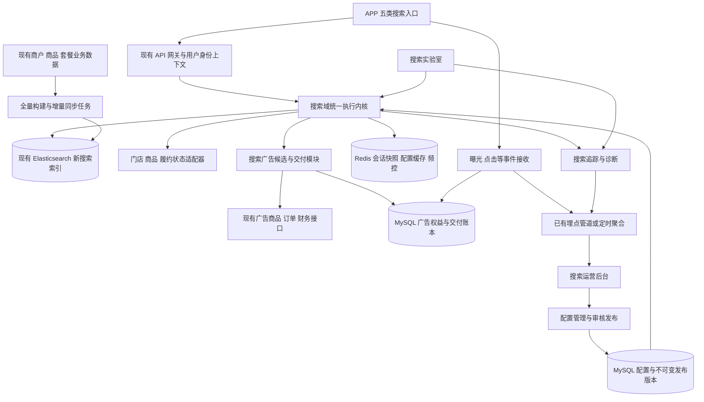

# 搜索运营系统重构方案（定版 v1.0）

> 文档状态：**已批准**（本文件为该方案在仓库内的唯一正式文档，取代 `docs/design/搜索系统后台界面_8e63a5d0.md` 与 `docs/design/搜索运营后台功能设计_8e63a5d0.md` 两份旧稿，见 §2.2）。
> 执行进度：**U1 纯前端原型已交付并通过三重验证**（`src/pages/SearchV2/`，29 项交互/边界测试全绿；typecheck、eslint、stat-order、confirm-modal、boundary、menu、secret-scan 门禁通过；浏览器 a–f 六项视觉验收 + 截图通过）。**配置管理域后端已落地**（用户授权第二阶段、legacy 增量）：5 张 `biz_search_*` 表经 `applyOnce`+后置校验建表、catalog 登记、启动就绪 200；引导/词库/场景/干预/发布 5 个 CRUD 接口已注册且受 JWT 保护（未授权 401）；23 项服务测试全绿（枚举/权重合计/乘数/有效期/状态机/逻辑删除）。**前端接真实 API + i18n、真实 ES 检索、投流交付/退款、生产发布尚未完成**（分别受 D0 资料与另行授权约束）。
> 适用范围：单城市、本地生活 APP，覆盖大首页、外卖、超市、团购、店内/垂类搜索。
> 已确认前提：公司已有搜索服务及 Elasticsearch；商业化优先参考现有广告推荐系统的投流广告，同时支持按周期售卖。
> “全新构建”指搜索产品模型、配置体系、检索编排、干预规则和排查链路重新设计；不等于重建公司账户、财务、商户主数据或另起一套 ES 集群。

## 〇、执行进度与门槛（落地追踪）

| 阶段 | 内容 | 状态 | 阻塞/前置 |
|---|---|---|---|
| 设计定版 | 本方案落库 `docs/design/`，登记旧稿被替代 | ✅ 已完成 | — |
| U1 纯前端原型 | 九模块信息架构、列表/表单/详情、实验室、五场景 APP 预览 | ✅ 已交付并浏览器验证 | — |
| 前端 API 层 + 五配置域接线 | `searchConfig.ts` 五域类型化+Mock 降级（契约测试 7/7）；`searchBridge.ts` 泛化+集成契约测试 10/10；引导/词库/场景/干预/发布均端到端接后端（浏览器验证：GET/POST 200、刷新回显、发布 submit/approve 落库 status=2）；ads 属 B3 保持原型；i18n chrome/九模块名/列表面/表单 chrome/概览页 OverviewPage/实验室 LabPage/消费者预览 ConsumerPreview chrome 已完成（zh-TW/en 双语；check:i18n + check:i18n-fallback + typecheck + SearchV2 测试 39/39；浏览器中英双语 DOM 验证 0 key 泄漏（正文 + aria-label），a11y 快照存 .local/searchv2-lab-i18n-20261031.a11y.txt）；**i18n 重构后回归实测**：五域 GET 全 200，词库新建 `POST /api/search/lexicon` → 200 并跳转 detail id=2，刷新后从库回显 `qa-i18n-regression → 漢堡`（非会话内存假象） | ✅ 已交付并浏览器验证 | 专属 search-v2 菜单与权限、剩余数据值（**区域 REGIONS 与 previewFixtures 演示店名耦合**，店名内嵌区域；以及 FIELD_SCHEMAS 标签与 select 候选值（source/category/match/slot）；已完成的**三刀枚举 code 化**：（一）搜索场景；（二）流程状态 `SEARCH_STATUS`；（三）**配置类型 `KINDS`**——17 个 code（guidance: placeholder/hotNatural/promoted/candidate；lexicon: business/alias/directionSynonym/correction/banned；scenarios: policy；interventions: demote/exactAdmit/boost/spread；ads: trafficPackage/cycleSlot；releases: configVersion），code 全局唯一防跳域同形；searchBridge 的 GUID/LEX/ACTION 双向映射表改为 code↔整型（后端 word_type/action_type 契约不变），RecordPage 字段过滤/告警分支/权益卡条件、PrototypeTable 类型列/筛选下拉/summary 比较位均改用 code，显示统一走 `searchV2.enum.kind.*`（17 键双语）；新增三条枚举契约测试（场景/状态/类型，含“各域 kind 必属本域枚举”与“code 全局唯一”）。注意：本轮发现 `推廣搜索` 是 `推廣搜索週期位` 的子串，故禁用全局 sed，逐处精确替换；同时 `validateDraft` 改为**返回 i18n key**（由 RecordPage t() 展示，含新增的 storeNoAd/homeAdLimit），并清理 RecordPage 权益卡/发布元信息/校验说明 HelpPopover 与 index 导航 aria-label 等残余硬编码 chrome；类型筛选「全部類型」哨兵改为空串，避免未选值与业务数据同形；新增两条枚举契约测试（场景+状态，含“示例记录每条值必属枚举”）防回退；**已实测口径缺口**：词库域表单「名稱」不入库也不展示（列表按 原詞→標準詞 组装，刷新后仅 id=2 的 alias/entity/wordType 回显），发布域 name/channel 同理不入库——名称字段已定版并已代码实现（见下）；另修正 SearchV2 全量繁中正字 `精確准入`→`精確準入`（15 处，含枚举字面量与桥接双向映射，后端 action_type 为 INT 故无库数据影响）。**已按定版实施「名稱」权威字段（待库应用）**：新增迁移 `search:config-name-v1.1`（已登记 catalog，`applyOnce`+后置校验，先查 INFORMATION_SCHEMA 再 ALTER，不吞异常），给五表各补一个按名词前缀命名的列（guidance.config_name / lexicon.entry_name / scenario.scenario_name / **intervention.rule_name**—与 target_name（被干预对象名）语义不同 / release.release_name）；列可 NULL（存量行无法回溯），服务层新增/更新强制非空且 ≤60 字；实体/类型/桥接双向映射完成，读取时对 NULL 回退为业务字段组合；过渡性质的「名稱是否會落庫」HelpPopover 及其 3 个 i18n 键与锁定测试已同步删除（避免文案与真实契约矛盾）。**尚未完成（外部阻断）**：本地出口 IP `172.26.63.236` 无法连接 SQLPub 开发库（直连 pymysql 也返回 1045 Access denied），后端因此无法启动，导致【迁移在真实库落地 + 列存在核对 + POST 名称回显】三项验证挂起；需在云控制台将当前 IP 加入白名单（或切换网络）后重启验证。代码层证据：后端 BizSearch 5 类 + MigrationCatalogTest 全绿（含新增“名称缺失必须拒绝”负例），`npm run verify` 全绿 EXIT 0（1670 项），新增桥接契约测试：“五个域保存都把名称下发到各自 *_name”与“无名称存量行回退为业务字段组合” |
| D0 方案与接入确认 | 现有 ES 版本/Mapping/容量、APP 搜索接口、源数据契约、投流交付执行方、财务接口、埋点与合规口径 | ⛔ 未开始 | **需相关负责人提供资料**；本仓库无生产 ES 客户端、APP 搜索代码不在此仓库（§2.1 已核实） |
| B1 搜索基础闭环 | ES 新索引、同步、五作用域自然搜索、诊断 | ⛔ 未开始 | 依赖 D0 + 真实 ES 测试环境；不伪造离线 ES（配置/发布后端已完成） |
| B2 受控运营 | 词库/降权/精确准入后端 CRUD+审批 + 前端接线 + 审批端点接入 | 🟡 大部分（后端+前端接线+审批流转已完成并浏览器验证：发布 submit/approve 落库 status=2；专属菜单权限、i18n 待接） | 依赖 B1 的 ES 生效 |
| B3 商业化闭环 | 曝光包、搜索定向、密度、回执/配额/退款、周期推广词、效果统计 | ⛔ 未开始 | 依赖 B2 + 财务/广告交付接入 + 另行授权 |
| G 上线验收 | 自然搜索灰度、广告小额试售、对照实验、运维演练 | ⛔ 未开始 | 依赖 B3 + 生产发布授权 |

> 门槛纪律：B1+ 不在缺少真实 ES/APP/财务基础设施与 D0 资料时以模拟实现冒充完成——这会违反 §1.1 原则 6（禁止另写模拟算法冒充真实结果）、§8.3（不制作虚假预测）与最高优先级「高效开发模式」规则（第二阶段须待 UI 确认后再接后端/DB/ES）。

## 一、决策摘要

### 1.1 推荐方案

采用 **ES 检索 + 轻量业务排序 + 独立广告候选池 + 受约束混排 + 版本化配置发布**。

核心原则：

1. **先能找到，再谈变现**：关键词相关性、业务频道、可服务范围和商品可售性构成硬约束，不能通过提高广告权重绕过。
2. **自然排序与付费投放分轨**：商家花钱购买的是明确标注的广告曝光或周期资源，不是隐蔽购买自然相关性。
3. **五个入口共用一个内核**：通过场景配置与对象类型区分，不建设五套独立搜索服务。
4. **高人气商家可以调控，但不能破坏明确找店需求**：支持泛词降权、精确匹配准入、同集团打散；明确搜索品牌/店名时保留正确结果。
5. **小团队保持模块化单体**：沿用现有 React + Ant Design、Java 17 + Spring Boot + MySQL；新增搜索业务模块，不默认拆分多个后端 Deployment。
6. **配置必须可解释、可验证、可回滚**：线上与实验室调用同一检索及排序内核，禁止前端另写一套模拟算法冒充真实结果。
7. **先形成可交付闭环，再增加算法复杂度**：首期不建设向量平台、深度排序训练平台、实时竞价市场或自动调参系统。

### 1.2 首期商业产品

| 产品 | 售卖内容 | 收费与履约口径 | 定位 |
|---|---|---|---|
| 搜索投流包 | 指定品牌、频道、区域和相关搜索需求下的有效广告曝光次数 | 预付套餐/阶梯计价；按有效曝光消耗额度；不重复按点击扣费 | 核心营收产品 |
| 搜索引导周期位 | 搜索激活页的独立“推广搜索”资源位 | 按天/周/月预付；售卖约定时段的资源占用权，不承诺自然排名或成交 | 辅助营收产品 |
| 自然热搜 | 真实搜索趋势榜 | 不收费；不能用付款修改自然热度数值 | 用户体验与需求发现 |

不将 CPC、CPA/CPS 或竞价拍卖纳入首期必做。曝光包可展示 eCPM、eCPC 和广告关联成交报表，但这些分析指标不改变合同计费方式。

### 1.3 本次及未来实施影响

| 项目 | 本次交付 | 审核后预计影响 |
|---|---|---|
| 前端 | 仅方案 | 重建运营页面；APP 增加广告标识、版本兼容、曝光回执和场景参数 |
| 后端 | 只读核查 | 新增搜索域、广告适配、诊断与同步模块，沿用现有启动装配 |
| 数据库 | 无修改 | 新增搜索配置、发布版本、投放权益及交付账本；不覆盖旧业务表 |
| API 契约 | 提出新契约 | 新版本搜索接口；旧 APP 通过适配与开关平滑切换 |
| ES/基础设施 | 不连接或修改生产集群 | 在已有集群建立新索引与别名，评估容量及权限，不原地改旧索引 |

## 二、现有系统核查及边界

### 2.1 核查结论

本次核查了菜单种子、相关前端页面、投流定价和下单代码、既有设计文档。未进入生产 APP 或竞品商家后台，未读取生产 ES 的版本、Mapping、索引规模及查询日志。

| 已核实内容 | 证据 | 对新方案的影响 |
|---|---|---|
| 搜索系统已有 5 个菜单分组、14 个叶子菜单 | [菜单种子](file:///Users/yangjingjing/Desktop/SARY/backend/modules/legacy/src/main/java/com/mftb/admin/config/DataInitializer.java#L2625-L2644) | 可以明确逐项合并、保留和退役，不凭空另建一套菜单清单 |
| 全局配置中的若干“保存”只更新前端状态并提示成功 | [全局配置](file:///Users/yangjingjing/Desktop/SARY/src/pages/SearchConfigNew/GlobalConfig/index.tsx#L109-L216) | 页面存在不代表配置已经下发 ES；新系统要展示真实生效版本 |
| 搜索校验包含本地规则分析和商家结果工厂 | [搜索校验](file:///Users/yangjingjing/Desktop/SARY/src/pages/SearchVerify/index.tsx#L59-L155) | 新实验室必须接真实内核，不能继承这些结果作为线上证据 |
| 旧维度策略包含“未购买广告天数扣分”和广告消费加分 | [维度策略](file:///Users/yangjingjing/Desktop/SARY/src/pages/SearchConfigNew/ChannelStrategy/index.tsx#L121-L143) | 新方案不迁移该隐式付费惩罚逻辑，以显式广告和受控流量治理替代 |
| 投流销售采用预付曝光包、套餐/自定义数量、阶梯价格、财务扣款 | [投流销售服务](file:///Users/yangjingjing/Desktop/SARY/backend/modules/legacy/src/main/java/com/mftb/admin/service/impl/AdSalesTrafficServiceImpl.java#L68-L226) | 优先复用商品与交易模式，不从 CPC 竞价系统起步 |
| 投流配置已有可用性、兴趣匹配、频控、冷启动及相似推荐参数 | [投流配置定义](file:///Users/yangjingjing/Desktop/SARY/src/pages/Recommend/TrafficAlgorithmConfig/config.ts#L12-L165) | 只复用适合搜索且能验证执行的能力；不能将参数存在等同线上算法已执行 |
| 瀑布流部分新增配置仍为浏览器本地扩展 | [瀑布流扩展存储](file:///Users/yangjingjing/Desktop/SARY/src/pages/waterfallConfig/waterfallExtStore.ts#L1-L10) | 不直接将整套瀑布流配置作为搜索生产配置源 |
| 当前后端是 Maven 模块化单体，一个启动装配单元 | [后端工程说明](file:///Users/yangjingjing/Desktop/SARY/backend/pom.xml#L21-L46) | 搜索首先增加域模块，不按菜单拆微服务 |

特别说明：本仓库未检索到已接入生产 ES 查询客户端的充分证据；这不否定公司已有搜索与 ES，说明线上检索实现和接入资料需要由相关团队提供。曝光消耗的线上执行方也需要核验，本次只确认了销售及额度字段等代码。

### 2.2 既有文档处理

- [旧后台界面方案](file:///Users/yangjingjing/Desktop/SARY/docs/design/搜索系统后台界面_8e63a5d0.md)和[旧功能设计](file:///Users/yangjingjing/Desktop/SARY/docs/design/搜索运营后台功能设计_8e63a5d0.md)包含 Vue/Element Plus 与 Mock 设想，不作为新系统技术依据。
- [APP 搜索体验设计](file:///Users/yangjingjing/Desktop/SARY/docs/design/用户端搜索体验设计_2026-10-26.md)中“五作用域、店内隔离、卡片信息可比、历史可清除”继续采用；其 Mock 接口、即时计数和旧字段命名不直接作为生产契约。
- 遵守[分系统独立工程改造方案](file:///Users/yangjingjing/Desktop/SARY/docs/design/分系统独立工程改造_63bd100a.md#L9-L23)的模块化单体和全量门禁决策。
- 本方案审批通过后，登记前两份旧搜索方案为“被替代”，保留历史记录；本次不改写或删除它们。

## 三、竞品分析：事实、推断与取舍

### 3.1 证据口径

- **A：官方公开资料**，可支持相应产品范围内的能力判断，不代表已经获得完整后台或当前精确权重。
- **B：公开体验文章/历史接口资料**，只能说明对应时期、入口或版本的表现。
- **C：设计推断或待实测假设**，不能写成竞品已确认功能。

本次是公开资料调研，不是三款 APP 的同机、同地址、同账号对照实测。尤其不能将“京东主站能力”等同“京东外卖能力”，也不能把饿了么历史 API 当作淘宝闪购当前契约。

### 3.2 对比结论

| 维度 | 美团/美团外卖 | 京东外卖 | 淘宝闪购 | 本公司取舍 |
|---|---|---|---|---|
| 搜索入口与作用域 | 到店搜索广告官方资料明确以 POI 为主要对象，关联商品/团单；外卖与到店不能混为一套参数。[S1][S2] | 品牌官方说明可从京东 APP 秒送频道搜索品牌进入外卖；公开独立 APP 体验指出其承接秒送业务，但购物频道搜索属于另一作用域。[S3][S4] | 官方搜索算法说明明确同时输出商品、店铺，要求满足本地服务和配送范围。[S6] | 首页聚合、频道隔离、店内强隔离；显式显示当前范围 |
| 结果布局 | 搜索广告与自然结果样式接近；公开技术资料强调首位、首屏广告相关性损失。[S2] | 公开体验显示商家信息流和频道入口；外卖结果页当前精确 Tab、广告位序列未获可靠证据。[S4] | 官方可确认商品/店铺并存、去重打散；当前各入口具体卡片布局仍需 APP 实测。[S6] | 外卖以商家卡为主，超市以商品卡为主，团购以套餐卡为主；全局分频道分组 |
| 自然排序 | 可确认相关性有独立评估；公开模型实践不能据此还原所有自然排序权重。[S2] | 京东隐私政策提及搜索排序、位置、用户偏好及销量/价格选择；这是京东平台级资料，不能直接宣称外卖完全一致。[S5] | 官方披露纠错、意图识别、召回、相关性排序、打散去重，并使用历史行为特征。[S6] | ES 文本召回 + 可解释质量/距离/热度排序，先不训练神经网络 |
| 广告排序 | 点金官方历史说明：配送范围内综合出价和门店质量；搜索广告技术资料：相关性过滤和靠前广告门槛。[S1][S2] | 未获得可确认的外卖专属竞价、计费和坑位说明；不能套用京准通电商搜索广告规则 | 当前搜索专属广告计费、坑位及后台参数未充分确认；不得从推荐算法说明推导拍卖公式 | 采用公司已存在的预付曝光包，不依赖竞品未证实机制 |
| 个性化 | 点金资料包含区域、时段、新老客定向；不等于完整个人画像模型可复制。[S1] | 京东公开政策支持偏好使用以及个性化内容/广告管理入口。[S5] | 官方披露用户画像、行为特征；推荐链路强调长尾和多样性。[S6] | 首期只允许弱个性化，用户可关闭；画像缺失时用同一套非个性化排序 |
| 后台配置 | 官方历史资料支持预算、出价、托管模式、区域、时段、新老客定向等。[S1] | 外卖专属后台未获公开证据 | 搜索运营后台未获完整公开证据；词库、地域供给、去重等是由算法描述推导的必要能力，不代表其菜单形态 | 配置围绕可执行动作设计，不照搬大厂菜单数量 |

### 3.3 可借鉴的产品规律

1. 本地生活搜索不只是“文本匹配”：结果必须在当前地点、频道、时间具有服务意义。
2. 当前查询是强意图，历史兴趣是弱信号。用户常买奶茶，不应导致搜索“纸巾”仍返回奶茶广告。
3. 首屏广告损害比后排更敏感，广告相关性应单独评估，不能只看 CTR。
4. 店铺、商品、套餐不能直接使用同一套卡片和价格排序；卡片类型和比较维度必须一致。
5. 配送、库存、门店状态不可靠时，再复杂的模型也无法修复错误供给。
6. 头部平台使用神经网络是其数据规模和工程能力下的方案，不是单城团队的首期前提。

### 3.4 从前台表现反推后台的验证方法

以下是下一步竞品实测表，不是本次已完成事实：

| 对照动作 | 能支持的判断 | 不能直接证明的内容 |
|---|---|---|
| 同词、同地址，切首页/频道/店内 | 是否有作用域过滤和差异化对象组织 | 后台是否有某个具体菜单 |
| 同词，切换两个地址 | 地域候选及履约过滤影响 | 仅凭名次变化认定距离权重数值 |
| 同地址，切午餐/非餐段 | 营业状态和时段信号可能影响 | 自动推定存在人工餐段加分 |
| 同地址同时间，新老账号对照 | 个性化可能影响结果 | 排除库存、实验分桶和即时广告库存造成的变化 |
| 综合切到销量/价格/距离 | 显式排序和广告处理策略 | 未看到广告就认定平台没有广告 |
| 品牌词、泛词、品牌+商品词对照 | 精确意图保护和广告相关性边界 | 倒推出实际广告出价或收费规则 |

建议每款 APP 采集 12 个代表词 × 2 个地址 × 2 个账号状态，并对重点词重复采样；记录 APP 版本、入口、地址、时间、排序项、广告标识、首 10 卡片和截图。只使用自有/授权账号，不抓取未授权后台、不下广告订单。竞品当前固定坑位、精确匹配方式及后台细节，以这些样本补证，不能影响本方案的安全底线。

## 四、产品目标与五类搜索体验

### 4.1 目标体系

- 用户目标：准确找到可购买/可使用的供给，减少改词、跳频道和无效进店。
- 运营目标：配置有作用域、有生效状态，异常可以定位到召回、数据、策略或展示环节。
- 商家目标：清楚购买了什么、消耗了多少、为什么没有投放、如何暂停或退款。
- 平台目标：广告净收入与搜索订单贡献共同增长，不以损害明确搜索需求换取短期广告收入。

**评价框架：搜索成交贡献 + 已履约广告净收入 − 补贴及履约相关成本 − 搜索基础设施增量成本。**

广告充值/预付金额不能直接当作已经实现的广告收入；按财务确认的履约进度统计。商品 GMV 也不能直接视作平台利润。

### 4.2 场景矩阵

| 场景 | 候选对象与组织 | 主要排序/筛选 | 广告策略 |
|---|---|---|---|
| 大首页综合搜索 | 外卖、超市、团购分组；各组最多先展示 4 张相关卡片，可进入频道看更多 | 默认综合；跨对象不提供统一“最低价”排序 | 整个概览最多 2 张广告，同频道分组最多 1 张；不插入无相关结果的频道 |
| 外卖频道 | 商家为主，卡内展示最多 3 个匹配菜品；商品 Tab 作为补充 | 综合、距离、销量；筛选营业中、自取、配送优惠 | 商家型搜索投流；必须确有匹配菜品/类目且可服务 |
| 超市频道 | 商品为主，提供商家 Tab；显示规格、门店、可售价格、库存状态 | 综合、销量、价格、距离；类目和规格筛选 | 商品型广告，不能只凭商家售卖其他品类就获得准入 |
| 团购频道 | 套餐为主，补充商家 Tab；每个套餐绑定可使用门店 | 综合、销量、价格、距离；有效期、预约、退款条件筛选 | 套餐型广告；过滤失效/不可用套餐，不应用外卖配送规则 |
| 店内/垂类 | 店内必须绑定店铺及频道，仅返回本店商品/套餐；垂类为频道内类目过滤 | 店内综合、销量、价格；垂类继承频道规则 | 首期店内不售卖跨商家广告；垂类可继承同类目搜索广告 |

业务对象应区分 **商户集团、实体品牌、门店、商品、套餐、APP 所属品牌**，禁止混用“品牌”字段。

### 4.3 统一交互

**搜索前**：当前作用域 + 本地历史 + 自然热搜 + 独立推广搜索区。

- 历史按 APP 品牌和作用域隔离，最多 10 条，可单条删除/全部清空；退出账号清除其本地历史。
- 搜索框底纹为空输入提示，不假装用户已输入；点击搜索框进入输入态。若用户主动点击某个推荐词，才提交该词。
- 首期不将底纹词出售为隐蔽广告，也不支持任意外链跳转。
- 自然热搜与付费引导分区显示；付费项明确标记“广告”，不标成真实热度排名。

**输入中**：200ms 防抖，取消过期请求，显示最多 8 条联想；首行保留原词提交入口。联想提供“店铺/商品/套餐/分类”标签，首期不插付费联想。

**搜索后**：保留关键词、作用域、排序和筛选条件；卡片按频道展示可比较的信息。网络错误、无结果、部分频道失败不能使用同一个空态。

**无结果**：先展示真实零结果说明及修正建议；跨频道出口须由用户主动点击。推荐替代内容单独分区，不能冒充命中结果；首期不在零结果区强行填付费广告。

**位置**：允许定位授权或用户主动选择位置。没有位置时引导选择，不能静默假设用户位于城市中心。地图坐标系统一转换为 WGS-84 后进入 ES。

**显式排序**：选择价格/距离/销量后，首期关闭付费插入、个性化加分和人工分数升降，以免破坏排序含义；安全过滤、频道过滤和精确准入限制仍有效。

## 五、新菜单及功能模块

### 5.1 一级菜单建议：9 个，取消纯包装目录

门户继续使用 `system_code=search`。列表、新增、编辑、详情为同一菜单下的路由，不分别建立菜单权限。

| 菜单 | 建议菜单 key | 页面内容与主要操作 | 优先级 |
|---|---|---|---|
| 搜索概览 | `search-v2-overview` | 搜索量、零结果、成交、广告交付、异常及待发布提示 | P0 |
| 搜索引导 | `search-v2-guidance` | 底纹、自然热搜、推广搜索预览、联想运营；候选采纳、排期、停用 | P0 |
| 词库管理 | `search-v2-lexicon` | 业务词、店铺/品牌别名、有向同义词、纠错、禁限词；导入校验与影响样例 | P0 |
| 场景策略 | `search-v2-scenarios` | 五场景、对象类型、字段权重、自然排序、过滤、广告密度上限 | P0 |
| 商家干预 | `search-v2-interventions` | 泛词降权、精确准入、扶持、同集团打散；原因、期限、审批与影响对比 | P0 |
| 搜索广告 | `search-v2-ads` | 搜索资源位、定向、广告计划关联、周期排期、曝光权益、交付异常 | P0 |
| 搜索实验室 | `search-v2-lab` | 真实条件查询、历史快照、草稿/线上对比、未命中诊断、回归用例 | P0 |
| 效果分析 | `search-v2-analytics` | 搜索漏斗、零结果词、词/区域/频道分析、广告交付和效果分析 | P0 基础，P1 深化 |
| 配置发布 | `search-v2-releases` | 草稿、审核、定时发布、版本、回滚、变更审计；技术角色可见索引健康 | P0 |

核心页面设计：

- 场景策略：左侧场景选择，中部基础规则/自然排序/广告约束，右侧展示有效版本和代表词对比入口。
- 商家干预：列表直接展示命中范围、干预类型、受影响词类、期限、审批人；不能只有一个“权重值”。
- 搜索广告：分别展示“已购买额度”“已有效消耗”“暂占额度”“待投放余额”，以及无相关需求、频控、下架等不可投原因。
- 搜索实验室：上方条件区；中部 APP 卡片预览与排名表；下方解析、过滤、打分、混排和版本信息。技术详情只向有权限人员开放。
- 发布页：明确区分“已保存”“已审核”“已发布”“所有服务实例已加载”，不能只显示一个成功 toast。

### 5.2 旧菜单逐项处置

| 旧菜单/能力 | 处置 | 新归属及理由 |
|---|---|---|
| 全局配置、维度策略 | 合并重建 | 场景策略；删除重复权重入口、固定跨频道比例和无执行依据的因子 |
| 底纹配置 | 保留业务能力 | 搜索引导；不保留任意外链、任意颜色等低价值自由配置 |
| 热搜配置、热搜词库 | 合并重建 | 搜索引导内的“候选/已配置/已排期”，同一词不维护两套真值 |
| 权重干预 | 保留并重做 | 商家干预；移出搜索引导，增加精确准入、期限和审批 |
| 分词词库、同义词库 | 合并 | 词库管理；区分业务词、别名、同义关系和底层分析器，禁止统称“分词” |
| 停用词库 | 取消独立菜单 | 词库高级页签；默认不自动删除否定词、规格和品牌关键片段 |
| 搜索校验、底纹校验、热搜校验 | 合并重建 | 搜索实验室三个测试对象，共用上下文和版本信息 |
| 底纹报表、热搜报表 | 合并 | 效果分析的引导漏斗页签，并补结果搜索与广告链路 |
| 前端 Mock 的校验结果/模拟权限 | 退役 | 仅允许隔离的 UI 样例，不参与线上验证或鉴权 |
| 搜索内另建商户 CRUD | 不建设 | 引用商户运营主数据，避免重复维护 |
| 面向运营的索引删改、任意 DSL/Painless | 不建设 | 索引结构通过代码及发布流程管理；技术运维只使用受控任务 |

这里的“删除”是未来退役旧菜单和实现，不是删除历史订单、账本、审批或审计数据。

### 5.3 与其他系统的职责边界

- **搜索运营系统**：词与供给匹配、自然排序、广告准入与展示、搜索诊断。
- **广告推荐系统**：广告商品、销售定价、投放订单及通用商业规则；搜索页作为一种新流量场景。
- **店铺经营系统**：后续商家自助购买、计划查看；首期可先由内部运营/BD 代建。
- **财务结算系统**：账户、预付资金、退款、收入确认、对账；搜索不得维护第二个余额。
- **商户运营/交易系统**：门店、商品、价格、库存、服务范围、营业状态的权威来源。

新菜单权限不从旧的 `edit` 自动继承 `publish/refund/diagnose-user` 等高风险能力；重新授予并测试。同步后端种子、路由、权限动作、导航映射、图标注册和系统归属。图标在搜索系统内不得重复。

## 六、系统架构与运行链路

### 6.1 架构图



图中模块是逻辑边界，不是每个方框一个微服务。

### 6.2 工程落点

- 新搜索后端域建议放在 `backend/modules/search`；跨域最小接口放 `backend/contracts/search`，由 `backend/bootstrap` 装配。
- 广告和财务适配器调用现有本地服务，保留事务边界，不顺手改为分布式扣款。
- 新前端页面独立置于搜索 V2 业务目录，由当前兼容前端工程承载；不在本需求内追加微前端运行时或全站工程搬迁。
- ES 集群复用；Redis 如已有则复用独立 key 前缀，如没有则将一套小规格托管 Redis 列为新增依赖和预算项，不假定公司已有。
- 同步、统计和清理首期采用受控定时任务；任务需单实例租约、重试和幂等，不引入 Kafka/Flink。

### 6.3 在线执行顺序

1. 校验请求、身份、APP 品牌、频道、地点及页游标。
2. 读取一个不可变策略版本，并固定到当前搜索会话。
3. 标准化关键词，识别店铺/品牌/类目/商品意图，生成有限查询扩展。
4. ES 在业务与地域范围内召回自然候选；并行召回有相关供给的广告候选。
5. 批量校验状态、可售性和履约；任何广告都不能绕过此步骤。
6. 对自然结果进行可解释排序，应用允许的非商业干预；保留干预前基准名次。
7. 广告模块进行权益、计划、频控、相关性和增量位置校验。
8. 混排器按场景规则插入广告，去重及同集团打散；无广告时自然结果补位。
9. 保存候选/顺序快照，返回卡片、游标、广告回执标识和搜索追踪号。
10. 曝光回执异步确认有效交付；事件统计不阻塞自然搜索响应。

### 6.4 配置发布

状态：草稿 → 待审核 → 已批准 → 待生效 → 生效中 → 已替代；驳回回到草稿，停止/回滚必须留审计。

- 发布快照包含：场景规则、词库版本、干预清单、广告约束、查询模板版本、分析器版本、索引代际和代码构建号。
- 涉及报价和订单权益的内容单独版本化，不允许回滚搜索排序时回滚财务账本。
- 同一作用域、同一时间、同一精度、同一优先级的冲突规则，发布时拒绝，不按更新时间随机覆盖。
- 普通规则按“全局默认 → 频道 → 区域/类目 → 指定词/实体”覆盖；同一商家的多个乘数不连续相乘，只取优先级最高的一条。
- 安全封禁始终优先；精准找店保护优先于商业性升降权；页面广告密度上限不能被商家计划覆盖。
- 普通配置生效目标 ≤60 秒；紧急关闭广告/违规内容目标 ≤10 秒，且有实例确认。任一实例未确认时展示部分生效并阻止扩大灰度。

## 七、Elasticsearch 技术设计

### 7.1 ES 的责任边界

| 能力 | 首期实现 | 不应作出的承诺 |
|---|---|---|
| 中文关键词召回、字段权重、精确/短语匹配 | ES `term/match/match_phrase/multi_match` | ES 自动理解所有口语、别称和复杂意图 |
| 类目、频道、品牌、状态过滤 | `bool.filter` + `keyword`/整型字段 | 靠客户端过滤完成安全隔离 |
| 地理检索 | `geo_point` 距离、`geo_shape` 服务面过滤 | 直线距离等于配送路线、ETA 或真实可配送性 |
| 热度及质量辅助排序 | `function_score`、预计算特征、受控业务排序 | ES 自动计算订单转化率或商家利润 |
| 拼音/繁简/同义/纠错 | 规范化与词库配合 ES；范围受控 | 无词库和数据准备即可完成全语义搜索 |
| 个性化 | 后端提供有授权的小型特征集并轻度调整 | ES 本身训练用户画像、pCTR/pCVR 模型 |
| 广告额度、计费、退款、审批 | 应用 + MySQL 事务 | 使用 ES 更新文档代替财务事务 |
| 历史排查 | 应用侧保存版本及结果/特征快照 | ES 自动保存每次历史结果，PIT 可永久回放 |
| 广告混排、分页去重、频控 | 搜索应用与 Redis/MySQL | 简单 ES boost 就等于完整广告系统 |

### 7.2 索引模型：三个逻辑索引

| 索引 | 文档粒度 | 用途 |
|---|---|---|
| `search_store_v{generation}` | APP 品牌 × 业务频道 × 门店 | 商家检索、门店地理与服务信息 |
| `search_offer_v{generation}` | APP 品牌 × 频道 × 门店 × 商品/套餐 | 商品、菜品、团购及店内搜索；通过 `offer_type` 区分 |
| `search_term_v{generation}` | 作用域 × 标准词条 | 联想、业务别名、可用热词候选 |

- 各自使用只读别名 `search_store_read`、`search_offer_read`、`search_term_read`；新旧代际互不覆盖。
- 首期不按区域、商家或日期拆业务索引；不把每个商品做成一个索引。
- 商品/套餐独立文档，禁止将某超市全部 SKU 放进门店文档的大型 `nested` 数组。
- 商品文档冗余少量门店过滤字段；价格、库存、服务状态不是 ES 的权威真值。
- 搜索广告候选从真实商品/门店索引与有效权益关联产生，不通过另造不真实商品获得匹配。

### 7.3 关键字段

| 字段组 | 示例字段 | ES 类型/约束 |
|---|---|---|
| 标识 | `doc_key`、`store_id`、`group_id`、`offer_id` | `keyword`；`doc_key` 全局稳定且可作排序同分键 |
| 作用域 | `app_brand`、`city_id`、`biz_channel`、`offer_type` | 枚举整型/`keyword`；应用端固定允许范围 |
| 文本 | `name_display`、`name_search`、`aliases_search` | 展示原文与检索标准化文本分离；检索字段 `text` |
| 精确匹配 | `name_exact`、`entity_aliases_exact`、`approved_exact_queries` | `keyword`；别名必须有来源和实体归属 |
| 业务语义 | `category_ids`、`business_terms`、`brand_entity_id`、`spec_terms` | `keyword` 数组；数量与长度受限 |
| 地域 | `location`、`service_area`、`operation_region_ids` | `geo_point`、`geo_shape`、`keyword`；经营区域不等于服务范围 |
| 交易展示 | `price_minor`、`currency`、`stock_state`、`business_state` | 金额使用最小币种单位整型；状态与源版本同时存储 |
| 质量特征 | `quality_norm`、`sales_30d`、`fulfillment_norm` | 已归一化数值/整型；标记统计窗口和更新时间 |
| 同步诊断 | `source_revision`、`source_updated_at`、`indexed_at` | 单调版本与时间，支撑乱序判断、延迟诊断 |

`app_brand` 不等于商家的实体品牌；`operation_region_ids` 不等于“店铺只能服务本行政区”。所有未知枚举拒绝，不默认为外卖。

### 7.4 中文、繁简、拼音和词库

首期确定采用低插件依赖方案：

1. 在应用标准化层执行 Unicode NFKC、大小写/空格规整、繁简统一，保留用户原词用于展示。
2. 复用工程已有 ICU4J 能力；不得将不同实体仅因繁简转换结果相同而直接合并。
3. 新索引文本基线使用 ES 内置 `cjk` 分析器，并用澳门/氹仔等实际业务语料验收；不强制安装 IK 或更换现有集群插件。
4. 店名、地方菜名、英文别名、常用拼音通过经审核的业务词与别名字段补足。拼音只在拉丁字母查询时走独立别名召回，不能声称解决所有多音字。
5. 同义词首期由应用按有向词典展开为最多 3 个等价查询分支，禁止无限递归、跨类目扩展和“奶茶=所有饮品”等过宽等价。
6. 纠错首期采用人工审核的高频错词表；展示“是否搜索……”，不静默篡改品牌。对全部中文字段默认开启模糊查询不纳入首期。
7. 底层分析器或索引期分词变化需新索引重建；普通词库的搜索期扩展可走配置发布。

ES 的 `synonym_graph` 支持搜索分析器中的多词同义处理，但更新机制和错误行为受版本/部署方式影响。[S10] 本方案首期不依赖在线修改所有节点的词典文件，避免把热更新风险引入生产检索。

### 7.5 地域与履约

- 外卖/超市：城市与频道过滤 → 服务范围空间过滤 → 批量履约确认。
- 当索引存储门店服务多边形，用户位置是点时，应使用“服务面包含/相交用户点”的关系；不能把 `within` 方向写反。[S9]
- `geo_distance` 用于距离排序和粗筛，不能用固定 3km 半径替代公司的真实配送范围。
- 团购：按套餐绑定的可使用门店匹配，距离取最近适用门店，不复用配送多边形作为强过滤。
- 店内：服务端确认 `store_id` 与 APP 品牌、频道一致，再加门店强过滤；不能相信客户端仅传一个店铺 ID。
- 休息店铺：泛词结果默认不占可交易列表；明确找店可返回标注“休息中/暂不可下单”的店铺卡，不投广告、不伪装营业。
- 状态数据超时且无法确认时，广告关闭；自然结果只允许返回不作可售/时效承诺的信息或丢弃该候选，订单与库存校验仍由交易系统完成。

### 7.6 召回与排序

先判断是否相关，再对相关对象排序。

**匹配等级：**

- T0：完整店名、实体品牌或已批准唯一别名命中明确找店意图。
- T1：名称/商品关键属性完整覆盖当前查询；短语命中优先。
- T2：类目、业务词或有向同义关系证明相关。
- T3：经过确认的纠错或弱扩展候选，独立作为补充结果，不参与首期广告。

T0 找店保护只适用于确有实体意图的查询，不能让任意商品标题完全等于泛词就获得品牌保护。

同一频道、对象类型、匹配等级内，使用以下起始评分：

`S = (wR×R + wQ×Q + wD×D + wH×H) × B × P`

- `R`：文本相关分数，经 `BM25 / (BM25 + k)` 饱和归一化；初始 `k=8`，离线验收后随策略版本发布。
- `Q`：权威商家质量/履约特征归一值；样本不足使用同类目平滑先验，不因新店无销量判为零质量。
- `D`：地理距离衰减；不是 ETA。
- `H`：30 日销量的 `log1p` 饱和分，不允许销量无限压制相关性。
- `B`：受审批的非付费干预乘数，默认 1，不含广告消费金额。
- `P`：弱个性化乘数，首期默认 1；有合规特征后限制在 1～1.05。

| 场景 | R | Q | D | H |
|---|---:|---:|---:|---:|
| 外卖 | 0.65 | 0.15 | 0.15 | 0.05 |
| 超市 | 0.75 | 0.10 | 0.10 | 0.05 |
| 团购 | 0.70 | 0.15 | 0.10 | 0.05 |
| 店内 | 0.90 | 0 | 0 | 0.10 |

这是可评审的初始参数，不是竞品权重或已验证最优值。运营调参时相关性权重不得低于 0.60，总和必须为 1；缺少可靠特征时展示缺失并按预定义规则使用先验，不能填假数据。

最终自然序按“匹配等级 → S 降序 → 稳定文档键”确定。跨频道或跨对象不直接比较 ES 原始 `_score`，首页按命中意图强弱决定分组顺序，同级使用固定场景顺序。

ES `function_score` 可实现乘法降权、距离衰减、热度饱和；分数不能为负，不能通过 `boost=-100` 实现降权。[S7] 首期复杂去重、精确保护和混排放在应用层，拒绝任意运营脚本。

**候选边界：**每个有效“频道×对象类型”常规候选最多 200 个；明确实体候选单独保留，防止被通用召回窗口挤出。初期首页最多 6 路受限查询，通过 `_msearch` 批量发送。该方案是窗口内排序，不承诺对全城全部文档做最优业务重排；验收需检查候选截断漏召回。

### 7.7 稳定分页

- APP 首期每页 20 条；综合排序最多提供当前会话前 200 条，超过后引导细化条件，不制造无限深翻页。
- 首次查询将最终自然顺序及必要广告决策存 Redis 会话快照，TTL 5 分钟；后续按服务端签名游标读取，不每页重新排序。
- 游标绑定查询、筛选、位置、品牌、用户/匿名会话及配置版本；修改条件重新搜索。
- 广告权益和可售状态每页复核；广告失效时由快照内未展示自然候选补位，不重新消耗曝光，不重复显示同一对象。
- 会话过期返回明确的 `SEARCH_SESSION_EXPIRED`，由 APP 提示刷新，不静默拼接另一版结果。
- `search_after + PIT` 适合 ES 内稳定排序和受控批量任务。[S8] 它不能直接解决应用重排后的分页，因此不把 ES 游标与业务排序混用；PIT 也不是历史审计快照。

### 7.8 数据同步与索引发布

- 源业务数据为真值。已有可靠变更事件通过适配器接入；缺少可靠事件的源模块补事务 Outbox，轮询消费，不新增重型消息平台。
- 事件至少包含 `event_id、entity_key、source_revision、operation、occurred_at`；删除、下架必须有事件，不只轮询仍存在的记录。
- 同一实体按单调版本幂等更新，拒绝旧事件覆盖新状态；删除墓碑的保留期必须长于最大重放窗口，防止旧更新复活已删除文档。
- 首次构建记录源水位 → 全量导入新代际 → 补追增量 → 校验数量/关键字段/样例词 → 原子切换别名。
- 普通内容入索引目标 P95 ≤60 秒；营业/可售状态目标 ≤10 秒进入状态适配层，ES 刷新延迟不能成为展示广告的理由。
- 增量失败指数退避重试；持久记录失败任务；每日按 ID/版本抽样及分段校验，不依赖文档总数相等来证明正确。
- 新旧代际同时保留至少 7 天并持续追增量，保证回退后的数据不过时。回滚代码/配置时不得直接切到一个已经停止同步的旧索引。

## 八、商业化：将瀑布流投流能力用于搜索

### 8.1 可以复用什么

| 现有能力 | 搜索中的处理 |
|---|---|
| 预付曝光包、套餐与阶梯价格 | 复用商品模型及服务端计价流程，新增搜索资源场景和定价快照 |
| 广告订单、推广金及退款基础能力 | 经接口复用，不建立搜索专用资金余额 |
| 区域/频道定向、商家准入 | 复用经验证的数据和规则；搜索增加当前词与真实供给的校验 |
| 频控、剩余流量分配理念 | 可复用接口或简化实现，搜索采用独立频控命名空间 |
| 用户兴趣标签 | 有授权且质量可靠时仅作为同等相关候选的弱信号 |
| 浏览后相似推荐、停留触发插入 | 不用于搜索列表的动态插队，避免回退后顺序变化 |
| 任意算法坑位、自然流量兜底算法 | 不直接复用；搜索的兜底只能是本次查询的自然结果 |
| 剩余流量包越多就无条件展示 | 不采用；必须先通过相关性、服务能力及频控 |

核心区别：**瀑布流从“用户可能感兴趣”出发；搜索从“用户这一次明确想找什么”出发。**

### 8.2 搜索投流包的产品字段

- 购买对象：APP 品牌、业务频道、门店或具体商品/套餐、有效曝光数量、套餐/自定义档位。
- 投放范围：区域、搜索结果资源位、允许时段、可选类目、可选关键词。
- 匹配模式：
  - 精确关键词：标准化查询等于已审核词条。
  - 类目/商品自动匹配：广告对象的真实在售供给满足查询，由搜索相关性规则判断。
- 首期不开放任意广泛匹配、竞品品牌词抢投和商家自填隐藏热词。
- 可配置排除词与每日投放上限；不能用“类别相近”替代商品真实存在。
- 流量包默认无自动作废期限，延续“消耗完退出”的业务方向；计划可以排期，暂停/结束计划不使剩余额度消失。新合同退款口径明确后再售卖。
- 新搜索订单与原推荐订单分开权益。旧瀑布流订单不会因增加搜索页而被默认跨场景消耗；跨场景通投以后需要商家明确同意和分场景交付记录。

### 8.3 广告排序与流量分配

准入：

`相关查询命中 ∩ 正确频道 ∩ 可服务/可售 ∩ 已支付有效权益 ∩ 计划有效 ∩ 未超频 ∩ 未达到额度 ∩ 未被禁止`

通过准入后：

1. 按匹配等级分组；首期广告仅允许 T1/T2，T2 必须是审核词库或真实类目/供给匹配，不允许纯兴趣命中。
2. 在同等相关候选中，使用“剩余可用额度 × 受限质量系数”的加权轮转；质量系数范围 0.8～1.2。
3. 每日投放上限作为节奏控制，不作为排名加分；首期不引入 pCTR/pCVR 训练和实时竞价。
4. 轮转随机种子、参与权重、配额快照写入诊断记录，确保可解释和快照回放。
5. 频控默认：同用户/匿名会话对同商家 2 小时最多 3 次有效广告曝光；同页同商家最多 1 张。该值是新搜索初值，不直接继承所有瀑布流参数。
6. 自然名次已经优于或等于拟广告位置的对象，不重复转为广告、不扣曝光包。该基准取付费因素和人工降权之前的自然名次，避免先降权再向商家售卖“提升”。

没有可靠质量/偏好数据时，在相关且合格候选中按额度轮转，不制作虚假的“智能转化预测”。

### 8.4 展示位置与硬上限

| 场景 | 首期规则 |
|---|---|
| 频道综合结果首 20 张 | 可用广告位为第 3、8、13、18 张；每连续 10 张最多 2 张，首张必须自然结果 |
| 大首页分组概览 | 全页最多 2 张、同分组最多 1 张；第一张和明确找店首卡保留自然结果 |
| 第二页及之后 | 首期不投搜索广告，先验证首屏收入与体验；后续扩展重新评审 |
| 价格/距离/销量显式排序 | 不插广告 |
| 明确品牌/店名搜索 | 不插竞品品牌广告；已在首位的同店不重复收费展示 |
| 店内搜索 | 不插跨商家广告 |
| 联想、零结果兜底 | 首期不投付费广告 |

“第 N 位”按结果卡片计数，不按屏幕行数计数；商品子项不另算坑位。广告不满足规则时直接补自然结果，不为卖满位置降低相关性标准。

所有广告卡片展示清晰“广告”标识，并提供“不感兴趣/为何展示”的轻量入口；不能依靠用户难以识别的颜色差异标识广告。

### 8.5 有效曝光、额度与账本

首期合同定义：**卡片至少 50% 面积连续可见 1 秒**，且回执通过服务端校验，才算一次有效曝光。该标准是本产品拟定口径，不声称所有竞品采用相同标准。

- 服务端为每张待展示广告签发不可伪造的 `decision_id` 和短时回执令牌，绑定计划、对象、资源位、会话及期限。
- 返回搜索列表不等于曝光；预加载、后台页面、未滚动到的卡片不消耗套餐。
- 客户端提供可见性回执，服务端校验签名、时间、授权计划、重复事件和频控；客户端可见性仍有作弊风险，签名不能证明真实观看，需 SDK 测试、异常监测和无效流量回冲。

额度约束：

`已确认有效曝光 C + 活跃暂占 R ≤ 已购买额度 Q`

- 发出广告决策前，在 MySQL 原子暂占 1 次额度，租约默认 120 秒。
- 有效回执在同一事务内将暂占变为确认；唯一键阻止同一 `decision_id` 重复确认。
- 到期未确认释放暂占；过期回执不追扣，避免释放后又被迟到事件双花。
- 额度耗尽/全部被暂占时停止新广告决策，但不影响自然搜索。
- 退款先暂停计划、停止新租约，等待有效租约结清/过期，再结算未消耗额度。
- 退款按订单实际支付额及剩余额度的累计比例计算，最后统一舍入并扣除既有退款；不能只用四位小数单价逐次相乘导致累计金额漂移。
- 赠送额度/赠送抵扣与现金分别记录，不得将赠送价值退成现金。
- 无效曝光以幂等冲正事件恢复权益；账本保留原记录，不物理删除。
- 财务/账本写入异常时关闭付费投放；自然搜索不依赖广告成功。

搜索消费使用次数权益，不在每次曝光时再次扣商家钱包。购买、退款继续走现有财务链；交付账本与财务账本关联但职责不同。

### 8.6 按周期售卖：先做推广搜索位

为避免首期同时建设两套结果页分配规则，周期商品先限定在搜索激活页的独立推广搜索区：

- 售卖单位：APP 品牌 × 频道/入口 × 区域 × 资源位 × 时间区间。
- 同一资源位同一时段只允许一份有效合同；周/月订单拆为日级排期以校验冲突和退款。
- 关键词与跳转目标必须审核；点击后进入正常搜索结果，不能直接伪造商家“自然第一名”。
- 只有明确合同覆盖的资源位可展示；售卖的是可用时段，不保证该时段有多少用户搜索、点击或成交。
- 无实际可服务供给时不展示该推广词。平台故障、商家停业、需求不足分别记录；平台未提供约定服务按未履约时段比例退款，商家原因按合同处理，不自动从自然热搜补量。
- 不再按这些展示次数扣搜索投流包；同一交付不能在两个产品重复收费。

### 8.7 容量与定价

- 搜索广告库存是“符合关键词、地点、频道和规则的实际机会”，不是全站 PV，也不是固定坑位数量。
- 初期使用最近 14 天数据估计：有效查询量 × 广告准入率 × 可投位置数 × 可见率 × 实际放量比例，再扣频控/去重影响。
- 重叠关键词、同义词和区域的需求须按请求机会去重，不能简单相加形成虚假库存。
- 预估可售量先按保守系数 0.6 控制，并扣除已有未交付权益；没有足够历史数据的细分词，只做小额度试售，不承诺消耗时限。
- 价格由商业化按频道和流量质量设套餐/阶梯，不沿用旧推荐流量单价作为搜索市场价；货币复用账户币种，禁止混币统计。
- 报表区分合同金额、预付余额、已履约收入、退款、赠送、未交付负债，以及广告关联订单；不能把总成交都归功于广告。

## 九、人工干预与高人气商家治理

### 9.1 支持的动作

| 动作 | 具体规则 | 边界 |
|---|---|---|
| 泛词降权 `DEMOTE_GENERIC` | 对目标门店/集团在指定区域、频道、词类下设置 B=0.3～1.0 | 只在同匹配等级内调整；明确找店不受商业降权影响 |
| 精确准入 `EXACT_ONLY` | 目标实体只有命中审核后的店名、品牌/唯一别名、实体+商品明确意图才参与跨店搜索 | 不是高 boost，也不是在取回前 N 条后再简单过滤；必须进入召回准入条件 |
| 同集团打散 | 泛词搜索首 10 卡片同集团默认不超过 2 张，候选充足时生效 | 明确搜索该集团/品牌时豁免；不为打散填无关供给 |
| 临时扶持 | 同等级内 B=1.0～1.2，需原因和期限 | 不突破相关性、履约、质量底线；付费扶持必须作为广告 |
| 违规屏蔽 | 由安全/内容治理权威状态禁止召回或投放 | 与商业降权分离；明确找店也不能越过安全封禁 |

### 9.2 “精确才展示”的语义

以某高人气汉堡品牌为例：

- 搜索完整品牌、已审核简称：展示其可服务门店，最近且营业门店优先。
- 搜索“品牌 + 汉堡”：识别到品牌实体且有对应供给，允许展示。
- 搜索泛词“汉堡”“午餐”：`EXACT_ONLY` 下不进入该品牌门店或其商品的跨店自然/广告候选。
- 搜索已审核且唯一指向该品牌的招牌商品别名：可列为精确准入词；普通“鸡腿堡”等共有商品名不能自动获得豁免。
- 进入该品牌店内后搜索其商品：正常执行店内检索，不让跨店流量治理破坏已进入店铺的体验。
- 别名有歧义时不判为唯一实体，展示消歧或普通相关结果。

限制必须覆盖商家结果、商品结果和实体联想，防止通过其他对象类型绕过；但搜索实验室应能说明是哪个准入规则导致未出现。

### 9.3 治理机制

- 降权原因建议是流量集中、可量化的服务质量问题或限期运营实验，不将“未购买广告”作为自动惩罚条件。
- 运营创建，产品/业务负责人复核；高影响规则不得自己审批自己。
- 泛词降权默认最长 7 天、精确准入默认最长 14 天；到期自动失效，延长须重新审批。
- 发布前展示代表词、预计受影响曝光占比、精确找店结果和其他商家变化。
- 监控精确找店成功率、改词率、投诉、搜索成交和头部曝光集中度；触及护栏自动停止新规则放量。
- 商业压力和用户体验发生冲突时，优先保护明确查询，使用广告产品、合理打散及新商家扶持获得收入。

## 十、搜索实验室与线上排查

### 10.1 三种模式必须区分

| 模式 | 输入 | 结果及承诺 |
|---|---|---|
| 当前条件校验 | 区域 + 频道 + 关键词，补充测试地址/坐标、时间、排序、筛选、店铺等 | 调用当前真实索引和策略；仅填区域时使用显式展示的代表测试点，不称为某用户复现 |
| 历史结果查看 | `trace_id`；或经授权的脱敏用户标识 + 时间范围 | 查看当时记录的请求上下文、结果顺序和配置；只读，不重新投放 |
| 历史候选重放/版本对比 | 已保存的候选与特征快照 + 策略版本 | 对同一候选集重跑确定性排序；不能据此证明历史全集召回完全一致 |

没有保存历史快照时，只能做“按已知条件重算”；页面必须显示这一限制。PIT、ES 索引代际或当前用户画像都不能替代完整历史快照。

### 10.2 必要上下文

区域、精确测试点、APP 品牌、入口、业务频道、类目/店铺、关键词原始与标准化形态、排序/筛选、服务端时间及时区、APP 版本、实验桶、策略版本、词库/分析器版本、索引代际、源数据版本、弱个性化开关、频控/配额快照、随机种子、缓存命中状态。

其中实际用户身份、原始位置和历史查询属于敏感信息，普通运营只能使用合成测试上下文。

### 10.3 结果解释

每张结果提供：

- 候选来自哪个索引及查询分支。
- 命中字段、分词/别名/同义词、匹配等级。
- 地域、营业、库存和服务校验结果。
- R/Q/D/H 原始值、归一值、乘数、规则来源及版本。
- 干预前自然名次、干预后名次、最终展示名次。
- 广告的相关性、权益、频控、暂占、去重和补位原因。

“为什么没有某家店”按指定目标单独诊断：索引不存在、超出服务范围、频道不符、状态失效、精确准入失败、被过滤、未进入候选窗口、窗口内名次靠后、被去重、广告权益不足等。

`_explain` 只解释特定文档的 ES 部分；应用层混排需要独立轨迹。`profile=true` 和详细 explain 为技术诊断按需开启、限频执行，不对所有线上请求启用。

### 10.4 无副作用与权限

- 实验室没有有效计费令牌；事件接口服务端拒绝诊断流量，不能仅依靠前端“不发送埋点”。
- 不消耗套餐、不增加真实频控、不记入商家效果和自然热搜。
- 不接受普通 APP 请求传入任意用户 ID、任意历史时间或草稿版本。
- 按真实用户排查需额外权限、工单原因、有限时间窗口，记录访问审计；不读取或借用用户登录 token。
- 当前比较使用固定候选/状态快照，清楚展示两版配置差异，避免将实时库存变化误判为策略差异。

### 10.5 留存

- 全量搜索记录最小摘要进入现有日志/埋点体系，包含追踪号、版本、耗时、结果数和错误类别，避免在普通访问日志中记录完整查询 URL。
- 详细诊断快照默认采样 1%，最多 1,000 条/天，保留 7 天；敏感字段加密、展示脱敏。
- 异常追踪可按工单临时提升采样，必须有范围、上限和自动到期。
- 不保证任意历史请求都有完整候选快照。广告有效交付事件则全量保留，按财务与当地合规要求归档，不能套用诊断日志的短留存。

## 十一、数据模型与 API 契约

### 11.1 主要数据实体

| 实体 | 核心内容 | 关键约束 |
|---|---|---|
| 搜索引导配置 | 词、类型、品牌、场景、区域、时段、排序、目标 | 同范围冲突检测；推广与自然类型不可混淆 |
| 业务词条 | 标准词、别名、有向同义/纠错、实体归属、适用类目 | 规范化去重、循环检查、歧义检查、批量上限 |
| 场景策略 | 候选窗口、字段权重、过滤、排序、广告上限 | schema 校验；禁止存可直接执行的任意脚本 |
| 干预规则 | 目标对象、查询条件、动作、乘数、期限、审批 | 必填原因；生效期；同精度冲突阻断 |
| 发布版本 | 不可变快照、校验和、审批、发布状态、实例确认 | 乐观锁；版本不可原地修改 |
| 广告计划 | 商业产品类型、定向、对象、关键词、权益引用 | 引用已支付订单；严禁越品牌/越门店投放 |
| 广告权益 | Q/C/R、支付及赠送拆分、订单与资源场景 | 非负、原子额度约束、订单引用唯一 |
| 暂占与交付账本 | 决策 ID、回执、租约、状态、冲正 | 决策/事件唯一，状态机与幂等事务 |
| 周期排期 | 资源位、作用域、起止日期、合同 | 禁止重叠占位；并发订单原子校验 |
| 同步任务/水位 | 源版本、水位、失败次数、错误码 | 幂等、可恢复、墓碑与版本校验 |
| 诊断快照/回归用例 | 脱敏上下文、候选、期望结果、版本 | 权限、留存、不能流入生产计费 |
| 日/小时聚合 | 搜索漏斗、词需求、广告有效交付和收入 | 统一分母、去重口径、货币与品牌隔离 |

实现时采用 MySQL 现有迁移机制，主键、必要外键、唯一约束、状态检查、审计字段和 `version` 乐观锁完整；金额使用 DECIMAL 或最小币种单位整型，禁止 float。ES 不保存余额真值。

### 11.2 业务枚举规范

- APP 所属品牌、业务类型、业务频道、区域和设备等沿用现有业务数据字典。
- 五类搜索场景单独定义 `surface`：首页/频道/店内；`biz_channel` 使用现有外卖、超市、团购编码；垂类由 `category_id` 表达。
- 不把“首页”和“店内”硬塞进三种业务频道编码。
- API 标识与数据库枚举之间通过明确适配，不混用现有业务频道 1/2/3、订单频道 2/3/4 和前端历史字符串。
- `store_id` 与历史 `store_code` 明确映射；金额币种与账户一致；统一 UTC 存储，业务排期按配置的本地时区解释。

### 11.3 对外接口建议

| 接口 | 用途 | 约束 |
|---|---|---|
| `POST /api/mobile/v2/search/query` | 提交/分页搜索 | 查询词放 body；每页 20、上限 50；游标绑定上下文 |
| `POST /api/mobile/v2/search/suggest` | 联想 | 查询长度、频率、最多 8 条；不返回内部得分 |
| `POST /api/mobile/v2/search/guidance` | 底纹、自然热搜、推广词 | 服务端解析地点与场景，返回版本及明确广告标识 |
| `POST /api/mobile/v2/search/events` | 曝光/点击等事件 | 批次上限、签名回执、幂等、防重放；不信任客户端金额 |
| `POST /api/search/v2/lab/query` | 当前/草稿校验 | 运营测试权限；强制无商业副作用 |
| `GET /api/search/v2/lab/traces/{traceId}` | 历史查看 | 额外诊断权限、资源范围、脱敏与审计 |
| `POST /api/search/v2/releases/{id}/validate` | 冲突与回归检查 | 返回可发布性、失败样例及影响 |
| `POST /api/search/v2/releases/{id}/publish` | 审批后发布 | 幂等键、版本锁、审核校验 |
| `POST /api/search/v2/releases/{id}/rollback` | 回到兼容版本 | 校验索引/代码兼容；不回滚账本 |

查询请求概念示例：

```json
{
  "surface": "channel",
  "bizChannel": 2,
  "query": "纸巾",
  "locationToken": "服务端签发的位置上下文标识",
  "tab": "offer",
  "sort": "relevance",
  "filters": { "availableOnly": true },
  "cursor": null,
  "pageSize": 20
}
```

- APP 品牌由受信客户端身份上下文确定，传入值只能校验一致性，不能自行切换。
- 用户身份由会话解析；匿名搜索允许，但使用受限匿名会话和反滥用策略，不强制登录后才能搜索。
- `locationToken` 不等于硬件定位真实性证明，仍需坐标范围、时效及异常校验。
- 响应至少含 `traceId、searchSessionId、policyVersion、sections/items、nextCursor、hasMore、partial、degraded`。
- 广告项额外含 `isAd、adLabel、decisionId、eventToken`；自然项不得伪装广告权益。
- 命中总量只反映检索口径，不包含广告重复项；履约后精确全量计数无法保证时返回下界/未知标记，不显示伪精确数字。
- 高亮返回文字片段结构，由 APP 安全渲染，不直接透传 ES HTML 高亮片段到富文本。
- 错误区分参数错误、位置缺失、会话过期、权限不足、部分频道失败和服务不可用；服务故障不能伪装“0 条结果”。

## 十二、安全、权限与合规

| 角色 | 允许 | 不允许 |
|---|---|---|
| 搜索运营 | 编辑词、场景草稿、普通测试、看聚合数据 | 发布自己创建的高风险规则、访问真实用户敏感记录、改账本 |
| 产品/业务审核人 | 审核策略、干预、资源位 | 绕过技术校验发布无效配置 |
| 广告运营/BD | 建广告计划、查看授权商家交付、提交退款申请 | 自改价格快照、额度、财务流水 |
| 财务 | 退款审核、收入确认和对账 | 修改搜索相关性、伪造曝光 |
| QA | 合成上下文测试、回归、草稿对比 | 触发真实计费或冒用用户身份 |
| 运维/技术诊断 | 索引状态、受控重建、经审批的追踪查询 | 从普通后台执行任意 ES DSL/脚本或直接改生产资金 |

安全边界：

- 前端校验只负责 UX；后端重验长度、类型、状态、作用域、时间、权限、资源归属和金额。
- ES 仅内网访问、TLS 和最小权限；检索账号只读别名，同步账号只写目标索引，管理权限独立。
- 同一城市仍隔离 APP 品牌、商家集团、门店和业务角色；单城不等于无需资源归属校验。
- 公共查询使用固定 DSL 模板和字段白名单，禁止客户端提供 `script/query_string` 或任意排序字段。
- 词库导入有行数/体积/格式限制、重复与循环校验；导出防 CSV 公式注入。
- 查询词、位置、用户行为最小化采集；有授权才使用个性化特征，支持关闭；不建立敏感人群标签用于差别定价或投放。
- 降权/精确准入有理由、期限、审计和申诉排查能力，不默认按“不买广告”惩罚商家。
- 广告标识、商业合同、数据留存和退款条款由实际经营地法务确认；不能因竞品在内地而假定相同法律自动适用于本平台全部区域。
- 禁止运营改真实曝光次数；补偿使用有依据的冲正/补量记录。

## 十三、可观测性、容量与故障降级

### 13.1 初始容量假设

以下只用于技术估算，必须以已有 ES 和 APP 流量测量替换：门店 ≤1 万、商品/套餐 ≤100 万、搜索峰值 100 QPS。不能将这些数字当作已测得现状。

- 单逻辑索引初始 1 主分片、1 副本；主分片超过约 30GB 或压测出现吞吐瓶颈时，重建评估，不预先大量分片。
- 高可用依赖现有集群实际故障域、可选主节点及数据副本分布；单节点不具备节点故障容错。扩容需另行预算批准。
- 存储估算：文档数 × 样本文档索引后体积 × 副本倍数 × 新旧代际倍数，另预留至少 30% 水位空间。使用实际样本测量，不按原始 JSON 大小直接报采购规格。
- 搜索日志不与生产商品索引无限混存；详细快照采样，报表优先小时/日聚合。
- 财务额度暂占的热点行、广告回执写入、源状态批量查询均须压测；不能只测 ES 单次查询。
- 不承诺现有低配后台实例无需增配即可承载 APP 搜索。保持模块化单体不等于可以忽略容量；达不到指标时先评审资源调整，再考虑拆运行单元。

### 13.2 建议服务目标

| 指标 | 首期验收目标 |
|---|---|
| 搜索 API | 正常负载 P95 ≤300ms，P99 ≤800ms，均不含移动网络 |
| 联想 API | P95 ≤150ms |
| 新系统基础可用性 | 目标 99.9%，以完整依赖链计，不仅 ES 进程存活 |
| 普通配置传播 | ≤60 秒且实例可确认 |
| 普通索引增量延迟 | P95 ≤60 秒 |
| 广告关闭/关键状态传播 | 目标 ≤10 秒；状态未知时停止付费展示 |
| 热门商家配额 | 并发测试不超消耗、不重复扣次数 |

这些是待审核的验收目标，不是本次测得成绩。

### 13.3 降级矩阵

| 故障 | 行为 |
|---|---|
| 广告服务/财务/额度库不可用 | 只返回自然结果，不发有效广告令牌 |
| 个性化特征不可用 | 乘数 P=1，保持普通搜索 |
| Redis 不可用 | 关闭付费频控依赖与会话分页，允许无广告首屏查询；旧游标明确失效 |
| 部分频道 ES 查询失败 | 返回成功频道并标记失败分组；不能把失败显示成无供给 |
| ES 全部不可用 | 优先通过既有接口回退到已验证旧搜索；否则错误态和重试，不全表 SQL 模糊兜底 |
| 上游履约状态超时 | 广告关闭；自然候选不作未经确认的可售、价格或时效承诺 |
| 配置校验失败或实例加载失败 | 保持最后一个兼容且验证通过的版本，报警并阻止扩量 |
| 报表/埋点延迟 | 搜索可用，报表显示数据延迟；交付账本不能用估算数补记 |

按检索、状态校验、广告、回执分别限流、隔离线程池/连接池、超时熔断，避免报表或诊断拖垮公共搜索。

## 十四、指标、实验与验收

### 14.1 指标定义

- 搜索量：服务端接受的有效 `search_submit`，排除测试、重试重复和机器人。
- 零结果率：非故障请求中无合格自然结果的比例；被安全拦截与技术失败单列。
- 搜索会话 CTR：有至少一次结果点击的有效搜索会话 / 有结果的有效搜索会话。
- 搜索下单转化：30 分钟内由带签名来源标识的搜索点击关联到本店/对应供给的支付订单；退款后统计净订单和净金额。
- 广告有效曝光：通过回执及去重的确认量；不是接口返回量。
- 广告关联 ROAS：净关联支付金额 / 已履约广告费用；不称为商家净利润率。
- 广告增量：通过实验对照估计，不能用末次点击归因证明因果。
- 自然热搜：按词的去重真实需求统计，排除付费引导制造的循环曝光、自动提交和测试流量；最低聚合人数门槛后才能展示。

首期使用现有埋点管道，或从结构化事件日志定时批处理形成小时/日聚合，不新建实时数仓。展示数据更新截止时间；订单归因依赖交易事件接通，否则只能展示到点击，不能填充模拟成交。

### 14.2 离线验收

建立至少 200 个“查询+场景+位置”标准用例，覆盖：

- 品牌/店名、普通品类、具体菜品、SKU 规格、套餐、歧义词、繁简、英文/拼音别名、错词、空白/超长输入。
- 五类场景、边界配送点、店内隔离、跨品牌、休息/下架/售罄、套餐失效。
- 受降权/精确准入的高人气商家与新商家。

初始门槛：明确找店且供给可用用例 Top3 命中 100%；跨品牌、跨店越界和已知不可服务广告为 0；广告不相关 Badcase@5 为 0。自然排序 nDCG@10 建议 ≥0.85，并与旧服务在相同标注集对比；若人工标注尚不稳定，先复核标注，不能调小断言放行。

### 14.3 工程测试

| 类型 | 必测内容 |
|---|---|
| 单元 | 规范化、词库展开、精确意图、评分边界、干预优先级、广告密度、去重和游标 |
| ES 集成 | 使用实际版本的 ES 测试环境验证分析器、中文召回、地理边界、别名切换、乱序与删除；Mock 不能替代 |
| 契约 | APP/后台 DTO、频道映射、旧接口适配、错误码、广告标识与曝光协议 |
| 安全 | 未授权发布、跨品牌/跨商家、任意用户排查、DSL 注入、词库 XSS、回执伪造/重放、导出泄露 |
| 并发/幂等 | 同订单重复购买、额度最后一次并发暂占、到期与回执竞态、暂停/退款与消费竞态、周期位超卖 |
| 数据一致性 | 重复事件、旧版本覆盖、删除后旧事件重放、索引重建追平及回退 |
| 客户端 | 可见面积与时长、后台切换、滑动回退、重试、重复事件、弱网、旧 APP 不支持广告协议 |
| 故障/性能 | ES 超时、Redis 故障、财务失败、同步积压、发布半成功、峰值两倍短时压力 |

需加入变异检查：故意移除频道过滤/诊断隔离/广告密度限制时，对应用例必须失败，确保安全断言确实有效。

### 14.4 线上验证与停止条件

- 先影子查询，新链路不展示、不消耗任何真实广告权益。
- 自然搜索先按 1% → 5% → 20% → 50% → 100% 灰度，再独立启用广告；两类变更不同时放大。
- 使用稳定用户/匿名会话分桶，不按每次请求重新随机。
- 单城流量小，实验至少覆盖两个完整周周期和主要餐段；提前估算样本量，样本不足只给方向性结论。
- 广告库存预估扣除对照组和未放量流量，不能以全量库存卖出后只在少量实验流量交付。
- 建议停止条件：出现越权、不可服务广告、配额超消耗、重复收费立即关广告；请求错误率连续两个 5 分钟窗口 >1% 且每窗 ≥200 请求，自动回退。
- 搜索支付转化相对下降 >5%、精确找店成功率下降、明显改词/投诉上升时暂停扩量；统计样本不足时人工评估，不用短时波动自动宣布收益。
- 决策同时看订单贡献、广告净收入和体验护栏，不以广告收入单指标胜出。

### 14.5 项目门禁

实现阶段遵循仓库 L0/L1/L2：日常增量验证，菜单/权限、共享契约、数据库、金额/额度改动强制 L2；提交和发布前全量验证。保留 lint、typecheck、Vitest、后端测试、菜单/依赖边界、i18n、秘密扫描等现有门禁，不放宽以加快交付。

本次仅设计，没有运行测试或性能压测，也没有完成 APP/浏览器验收。

## 十五、实施分期、人员与回滚

### 15.1 执行门槛

**本稿批准前不修改实现。** 批准后仍按项目两阶段规则推进：先 UI 原型确认，再接 i18n、后端、数据库和 ES。生产数据接入、资源采购、广告真实售卖和线上发布另外授权。

| 阶段 | 主要工作 | 退出条件 |
|---|---|---|
| D0：方案与接入确认 | 审核产品边界；提供现有 ES、搜索 API、源数据、埋点、投流执行和财务接口资料 | 负责人确认、数据契约和依赖清单可用 |
| U1：纯前端原型 | 9 菜单信息架构、关键列表/表单、实验室、广告报表样例；五场景 APP 布局示意 | 用户确认 UI；明确 Mock；不连接真实计费、不变更后端/i18n/数据库 |
| B1：搜索基础闭环 | ES 新索引、同步、五作用域自然搜索、引导词、基础诊断、发布版本 | 标准查询集和真实 ES 集成测试通过，可影子查询 |
| B2：受控运营 | 词库、降权/精确准入、实验室、权限与审批、灰度 | 精确保护、越界及回滚测试通过 |
| B3：商业化闭环 | 曝光包、搜索定向、密度、回执/配额/退款、周期推广词、效果统计 | 财务对账、超额/重放/退款竞态测试通过 |
| G：上线验收 | 自然搜索灰度、广告小额试售、对照实验、运维演练 | 体验及营收护栏满足、具备可操作回滚 |

排期估算：具备 2 名后端、1 名前端、1 名 APP 工程师、共享 QA/产品/运营，且源接口可用时，约 8～10 周形成首期可上线闭环；竞品补证、数据质量问题、ES 版本治理和外部接口等待另计。若只有 2～3 名工程师共享承担，应减少并行、延长排期，不能通过删减计费/隔离测试压缩工期。

### 15.2 首期明确不做

- 多城市分布式检索体系、跨区域集群和大规模微服务拆分。
- 向量召回、在线大模型改写、DNN/LTR 模型训练平台、自动竞价、自动调参。
- 任意动态 ES Mapping、任意脚本、无限 DSL 编辑器。
- 广泛错别字智能纠错、任意口语意图理解的效果承诺。
- 动态“猜你喜欢”插入正在浏览的搜索结果。
- 店内竞争商家广告、未标识付费自然排名、按未购买广告天数自动惩罚。
- 全量永久用户画像和无限期历史快照。
- CPC/CPA、商家竞价市场、复杂多触点归因、实时广告数仓。

以上不是宣称 ES 在技术上永远无法支持扩展，而是当前团队规模下没有足够数据、依赖或投入收益依据，不进入本期开发清单。

### 15.3 回滚方案

- **代码/API**：保留旧搜索入口；网关/应用开关按场景和客户端版本回退。新旧 APP 不混用未兼容的广告事件协议。
- **配置**：切回最后通过验证且与当前代码/索引兼容的版本；会话可继续用冻结版本或明确失效，不能半途换算法。
- **ES**：原子恢复只读别名到仍在同步的旧代际；回退前检查水位、关键状态和词库兼容。
- **数据库**：采用增量新增表/字段，不在切换期删旧表；回退查询路径不回滚已发生交易。
- **广告**：先停止新投放与暂占，完成已签发回执的结清和退款；旧 APP 无法正确标识和上报广告时只返回自然结果。
- **财务**：退款/冲正继续追加流水，绝不通过恢复旧数据库快照抹掉已付款订单。
- **退役**：至少经过稳定观察和依赖确认再下线旧菜单/接口；历史订单和审计只归档不删除。

## 十六、风险与审核确认项

### 16.1 关键风险

| 风险 | 应对 | 责任方 |
|---|---|---|
| 已有 ES 版本、分析器和容量未知 | D0 提交只读能力清单；测试环境验证；不把升级集群默认为本需求授权 | 搜索/运维 |
| 现有 APP 搜索执行代码不在本仓库 | 确认接口所有者和部署链；新接口通过适配接入，不能只完成后台页面 | APP/搜索团队 |
| 投流已有销售、缺少可验证交付闭环 | 核验执行服务；未证实前按需新建搜索交付链，不承诺直接复用完成 | 广告/后端 |
| 价格库存与 ES 不一致 | 状态版本、增量延迟、批量权威校验；广告失败关闭 | 交易/搜索 |
| 热门商家治理损害品牌搜索 | T0 保护、有限期限、发布测试、独立回退 | 产品/运营 |
| 卖出超过可交付需求的曝光包 | 保守预测、重叠去重、小额试售、剩余额度退款 | 商业化/财务 |
| 客户端虚假曝光/事件丢失 | 回执签名、去重、采样核验、异常冲正；承认首期风控边界 | APP/风控 |
| 单体资源被诊断/聚合任务占满 | 预算、线程/连接池隔离、限制详细追踪与后台任务 | 后端/运维 |
| 当前低流量无法快速得出显著收益 | 两周以上稳定样本，区分归因与增量，不虚构实验结论 | 数据/产品 |

### 16.2 审核清单

批准本稿时重点确认：

1. 首期采用“搜索曝光包 + 推广搜索周期位”，不建设 CPC/CPA。
2. 搜索与推荐订单默认分权益，旧订单不自动跨场景消费。
3. 明确找店受保护；高人气商家支持泛词降权/精确准入，但不按未购买广告天数自动惩罚。
4. 广告初始密度、自然首位保护、显式排序无广告、店内无跨商家广告。
5. 有效曝光标准、额度暂占、无效流量冲正和未交付退款条款。
6. 九菜单方案以及广告/搜索/财务的职责分界。
7. 首期 ES 功能边界、候选与分页上限，不做大模型/向量/竞价系统。
8. 提供现有 ES 与搜索接口、业务源数据和投流交付的接入负责人；城市、区域、币种、时区及经营法律适用范围最终确认。
9. 服务目标、投入人员与容量预算经测量确认；不将当前单体低成本目标误解为新增 APP 流量无需资源。
10. 本稿批准仅进入约定阶段；UI、完整业务上线、生产资源变更和真实收费各自通过对应验收。

## 十七、资料来源

### 17.1 竞品公开资料

- **[S1] 美团袋鼠学院：提升门店综合质量，玩转点金推广**，2019-05-29，官方历史商家材料；支持出价/质量、点击计费、预算及定向能力，不代表所有当前搜索场景规则。<https://collegewm.meituan.com/sg/post/detail?id=175&contentType=0>
- **[S2] 美团技术团队：预训练技术在美团到店搜索广告中的应用**，2021-12-02；支持搜索广告相关性、首屏风险、POI 与商品/团单关系，不用于还原当前外卖全部算法。<https://tech.meituan.com/2021/12/02/Application-of-Pre-training-Technology-in-Meituan-Search-Ads.html>
- **[S3] 星巴克：专星送登陆京东外卖**，2025-04-21；确认京东 APP 秒送频道品牌搜索入口。<https://www.starbucks.com.cn/about/news/support-jd-mod/>
- **[S4] 雷科技/新浪公开体验：我替你试了京东外卖 App**，2025-11-18；属于媒体体验，不作为当前固定广告位或计费方式证据。<https://t.cj.sina.cn/articles/view/5061312402/12dad7f9202002j7ys>
- **[S5] 京东基本功能隐私政策**；平台级位置、搜索历史、偏好与排序选择说明，不能直接等同所有京东外卖子场景。<https://ihelp.jd.com/n/help/tip/getTipsFacade.json?tipId=288>
- **[S6] 淘宝闪购平台算法原理及信息处理情况说明**，官方说明；支持纠错、意图、可配送范围、商品/店铺、排序与去重、个性化能力判断，未披露精确权重或搜索广告售卖规则。<https://terms.alicdn.com/legal-agreement/terms/privacy_other/20221107200441714/20221107200441714.html>
- 补充历史参考：饿了么搜索 API，展示地理、餐厅/食物混合检索及多种排序，但不视为当前淘宝闪购接口。<https://openapi-doc.faas.ele.me/v2/api/search.html>

### 17.2 Elasticsearch 官方依据

- **[S7] Function score query**：加权、乘法、衰减及非负分数约束。<https://www.elastic.co/docs/reference/query-languages/query-dsl/query-dsl-function-score-query>
- **[S8] Paginate search results**：深分页限制、稳定同分键、`search_after` 与 PIT。<https://www.elastic.co/docs/reference/elasticsearch/rest-apis/paginate-search-results>
- **[S9] Geoshape query**：索引几何与查询几何关系、包含/相交方向。<https://www.elastic.co/docs/reference/query-languages/query-dsl/query-dsl-geo-shape-query>
- **[S10] Synonym graph token filter**：搜索分析器、多词同义、更新及无效规则风险。<https://www.elastic.co/docs/reference/text-analysis/analysis-synonym-graph-tokenfilter>

ES 在线文档随版本更新；实施时必须锁定实际集群版本和客户端版本，不能直接照搬其他版本示例。

---

**最终建议：将本系统建设为“可运营、可收费、可解释的单城搜索基础设施”，而不是功能看似齐全、但缺少真实索引、交付账本和线上验证的配置集合。完成审核后再按阶段执行。**